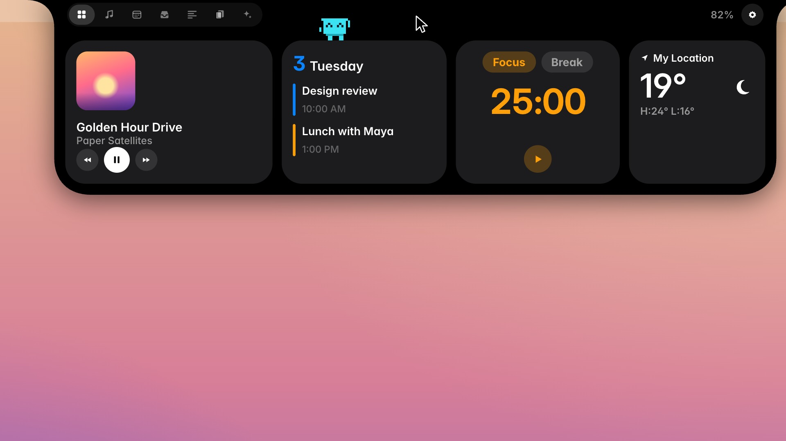
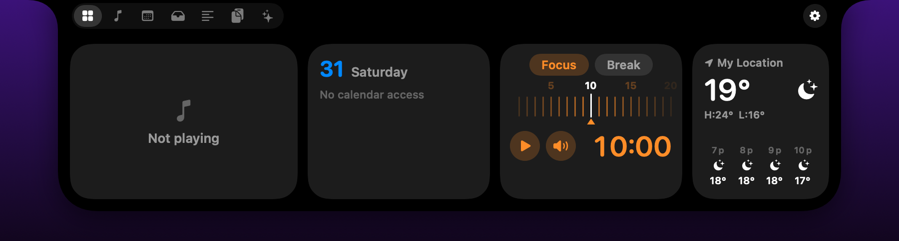

# Notchly

[](https://github.com/SuzalShrestha/notchly/actions/workflows/build.yml)
[](https://github.com/SuzalShrestha/notchly/releases/latest)
[](LICENSE)


Notchly turns the MacBook notch into a small panel for music, files, your calendar, clipboard history and coding agents.
Point at the notch and it opens. Move away and it closes.

**Website:** https://suzalshrestha.github.io/notchly/ · **Download:** [latest release](https://github.com/SuzalShrestha/notchly/releases/latest)

[](https://suzalshrestha.github.io/notchly/video/notchly-launch.mp4)

▶ **[Watch the launch film](https://suzalshrestha.github.io/notchly/video/notchly-launch.mp4)** (58 s)



Notchly is an independent, MIT-licensed project inspired by [NotchNook](https://getnotchnook.com/). It is not affiliated
with NotchNook or lo.cafe. It ships none of NotchNook's images, fonts or text. Some design values (notch geometry, springs,
colors) were measured from NotchNook's app and website; the [table below](#design-values-measured-from-notchnook) lists them.

## What it does

| Tab | ⌃⌘ | What you get |
|---|---|---|
| Nook | 1 | A row of widgets you pick: music, calendar, weather, focus timer, to-dos, activity, AI usage, Pulse (CPU, memory, network), clipboard, notes, tray, volume, Shortcuts, mirror, quick apps |
| Music | 2 | Artwork, scrubber, transport and synced lyrics for Spotify and Apple Music |
| Calendar | 3 | Day strip, agenda, Join buttons for Meet, Zoom, Teams and Webex, and a quick event composer |
| Tray | 4 | Drop files on the notch; drag them out, AirDrop or share them later |
| Prompter | 5 | A teleprompter right under the camera, with countdown and speed control |
| Clipboard | 6 | Searchable history of text, links, colors, images and files, with favorites |
| Agents | 7 | Each Claude Code session live: a step timeline with durations, files changed, a tool mix, an alert when it needs you, and a Claude pet that acts out what the agent is doing |

When the notch is closed it shows **live activities** beside the camera: the playing song, a running timer, an upcoming
meeting, charging, an agent at work, a volume change, or the number of files in the tray.

On a Mac without a notch, or on an external display, Notchly shows a thin handle at the top of the screen instead.

## Install

1. Download `Notchly.zip` from the [latest release](https://github.com/SuzalShrestha/notchly/releases/latest) and unzip it.
2. Move `Notchly.app` to Applications.
3. The build is ad-hoc signed, not notarized. On first launch, open System Settings › Privacy & Security and click
   **Open Anyway**, or run `xattr -dr com.apple.quarantine /Applications/Notchly.app`.

Needs macOS 14 or later on Apple silicon. Each release has a `Notchly.zip.sha256` file; check it with
`shasum -a 256 -c Notchly.zip.sha256`.

Notchly lives in the menu bar (no Dock icon). Open it again from Applications at any time to bring up Settings.
To update, use **Check for Updates…** in the menu bar menu, then replace the app in Applications.

### Connect Claude Code

The welcome tour, the empty Agents tab and Settings › Agents & AI Usage › **Install hooks** all do the same thing: it adds a small script to the `UserPromptSubmit`, `PreToolUse`,
`PostToolUse`, `Notification`, `Stop` and `SessionEnd` hooks in `~/.claude/settings.json`. Your other hooks stay; the first
time, the old file is backed up as `settings.json.notchly-backup`. New Claude Code sessions then show up in the Agents tab.
**Remove hooks** takes them out again.

## Privacy

Notchly has no accounts, analytics or telemetry, and no third-party code. Your data stays in
`~/Library/Application Support/Notchly` and the app's preferences. It connects to the network only for:

| What | Service | Sends |
|---|---|---|
| Weather widget | [Open-Meteo](https://open-meteo.com) | Approximate coordinates, or the place name you typed |
| Synced lyrics (can be turned off) | [LRCLIB](https://lrclib.net) | Track title, artist, album and length |
| Spotify album art | Spotify's image CDN | The artwork URL Spotify reports |
| Check for Updates (only when you click) | GitHub API | Nothing beyond the request |

AI usage is read from local Claude Code and Codex logs. Agent events arrive over a Unix socket that only your user can open.

### Permissions macOS may ask for

| Permission | Used by |
|---|---|
| Automation (Spotify, Music) | Reading the current track and controlling playback |
| Calendars | Showing events and adding the ones you create |
| Location | Local weather; deny it and set a place in Settings instead |
| Camera | The Mirror widget, only while it is on |

## Uninstall

1. Settings › Agents & AI Usage › **Remove hooks** (if you installed them).
2. Quit Notchly from the menu bar and delete `Notchly.app`.
3. Optionally delete your data:

```bash
rm -rf ~/Library/Application\ Support/Notchly
defaults delete com.sujal.notchly
```

## Troubleshooting

- **Nothing appears at the top of the screen.** Check Settings › General › Displays. On a screen without a notch the
  resting notch is a thin handle; point at the top center to open it.
- **macOS says the app is damaged or cannot be opened.** It is quarantined because it is not notarized; see step 3 of Install.
- **Music shows nothing.** Allow Notchly to control Spotify or Music in System Settings › Privacy & Security › Automation.
- **Agents tab stays empty.** Install the hooks (above), then start a *new* Claude Code session.
- **⌃⌘1–7 clash with another app.** Turn off navigation shortcuts in Settings › Keyboard Shortcuts.

Still stuck? [Open an issue](https://github.com/SuzalShrestha/notchly/issues/new/choose).

## Build, test, run

```bash
./verify.sh            # release build → build/Notchly.app, self-tests, PNG snapshots in build/snapshots
./make-app.sh --run    # build and launch
```

Works with Xcode or with only the Command Line Tools. With only the Command Line Tools, the scripts use the macOS 26.5 SDK
when it is installed: the macOS 27 SDK turns `@State` into a macro whose plugin ships only with Xcode.

Launch flags: `--selftest` (assert checks for all parsers and state machines), `--snapshot <dir>` (render every notch
state and widget to PNG), `--open <tab>` (open the notch at launch), `--settings` (open Settings at launch), `--dock`
(run as a regular app so UI-testing tools can see it).

Every push builds the app, runs the self-tests and uploads the snapshots on GitHub Actions. Pushing a `v*` tag that
matches the version in `Info.plist` also publishes a release with `Notchly.zip` and its checksum.
The website is plain HTML in [`docs/`](docs/), served by GitHub Pages.

See [CONTRIBUTING.md](CONTRIBUTING.md) for the code layout and guidelines, and [CHANGELOG.md](CHANGELOG.md) for what changed.

## Design values measured from NotchNook

| Item | Value | Source |
|---|---|---|
| Notch path | bottom radius 11 → 40 pt over +100 pt height; ears ≤5 → 24 pt over +300 pt width; cubic corners k = 0.62 | `NotchShape` disassembly + website notch module |
| Open spring | response 0.48, damping 0.88 | `NotchView.openAnimation` |
| Close spring | response 0.40, damping 0.95 | `NotchView.closeAnimation` |
| Reduce Motion | easeInOut 0.2 s | same functions |
| Open speed | standard ×1, slower ×0.8, slowest ×0.65 | `NotchOpenSpeed` |
| Notchless handle | 184 × 8 pt | `generalSettings.handleSize` |
| Content padding | 12 pt | `generalSettings.contentPadding` |
| Colors | `noteBG`, `selected`, `weekendPink`, … | `Assets.car` |
| Tabs and shortcuts | nook 1 … agents 7, ⌃⌘digit | `navigationShortcutsSettings` (modifier meaning inferred) |
| Settings keys | `generalSettings`, `clipboardSettings`, `mediaWidgetSettings`, … (JSON in UserDefaults) | user defaults |
| Enum cases | widgets, live activities, clipboard filters, weather conditions, agent phases … | Swift field metadata |

## Feature coverage compared with NotchNook

| NotchNook feature | Notchly | Notes |
|---|---|---|
| Notch shell: hover open, click open, Esc, haptics, multi-display, notchless handle | yes | vertical "scrub" gesture not built |
| Navigation dock (compact / icons / dots) + ⌃⌘1–7 | yes | |
| Nook widget grid + reorder | yes | reorder in Settings, not drag-in-place edit mode |
| Widgets: media, calendar, weather, timer, to-dos, activity, AI usage, pulse, clipboard, notes, tray, volume, shortcuts, mirror, quick apps | yes (15/15) | |
| Music tab: artwork, scrubber, transport, synced lyrics (LRCLIB) | yes | Spotify + Apple Music via AppleScript; no system-wide MediaRemote source, no queue, no app volume mixer |
| Media live activity + visualizer | yes | bars are simulated, not an audio tap |
| Volume HUD | yes | shown beside the system HUD, does not replace it |
| Tray: drop, thumbnails, drag out, AirDrop, share, persist | yes | no file converter |
| Clipboard history: 7 filters, search, favorites, retention, skip passwords, excluded apps | yes | no categories |
| Calendar tab: day strip, agenda, Join links, new-event composer, upcoming-meeting activity | yes | |
| Weather (Open-Meteo) | yes | no air quality |
| Timers / Pomodoro + live activities | yes | no focus music, no rain ambience |
| Prompter: auto-scroll, speed, countdown, scripts | yes | no voice-follow mode |
| Agents: Claude Code hook bridge (unix socket), sessions, steps, alert activity | yes | hooks install only on a button press (tour, empty Agents tab, Settings); no approve/answer from the notch; no Codex hooks |
| AI usage (local token scan of Claude Code + Codex logs) | yes | no provider quota APIs, no USD cost |
| Battery live activity | yes | |
| Pockets, Terminal, Lock-screen widgets, Messages, Downloads, Video downloader, Bluetooth/AirPods, Liquid Glass shader, Onboarding, automatic updates | no | not built yet; updates are a manual Check for Updates |

## License

[MIT](LICENSE). Security issues: see [SECURITY.md](SECURITY.md).
